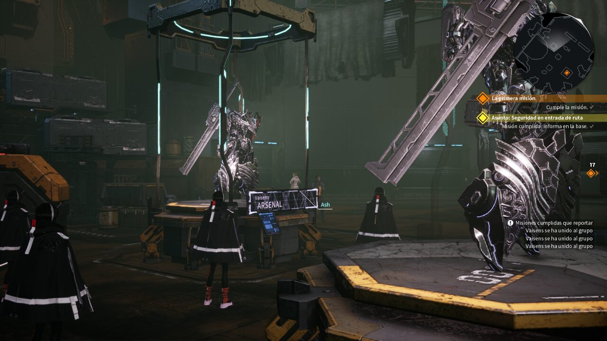
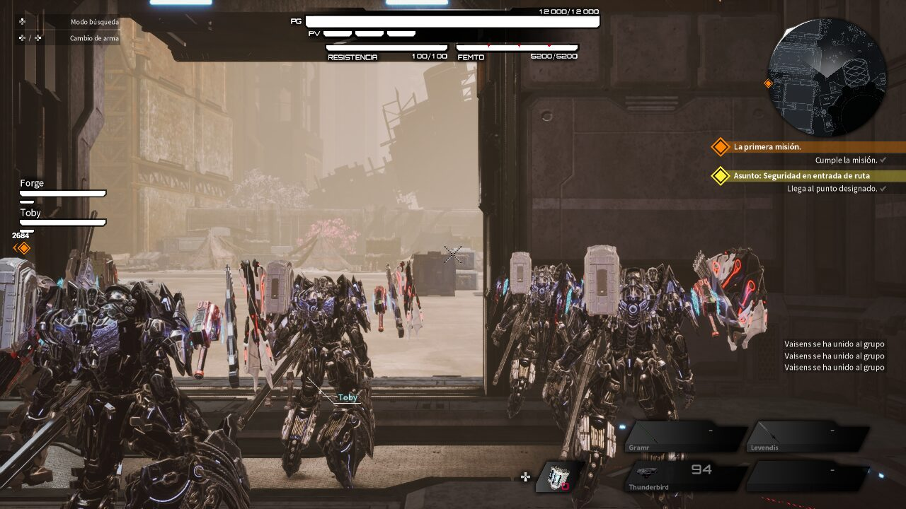
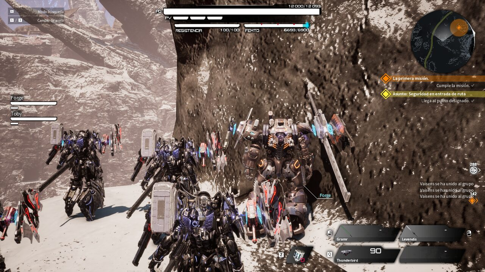
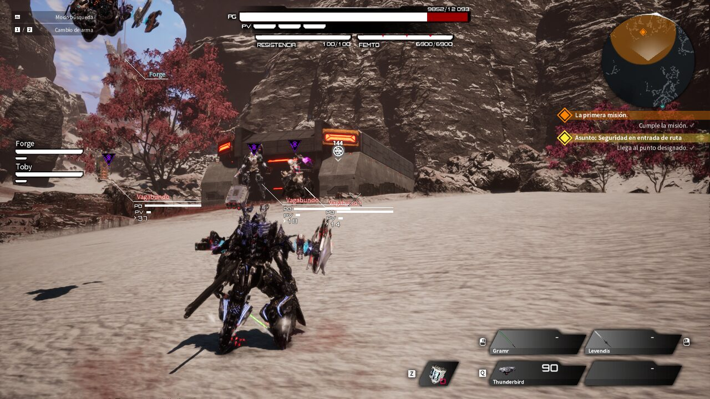
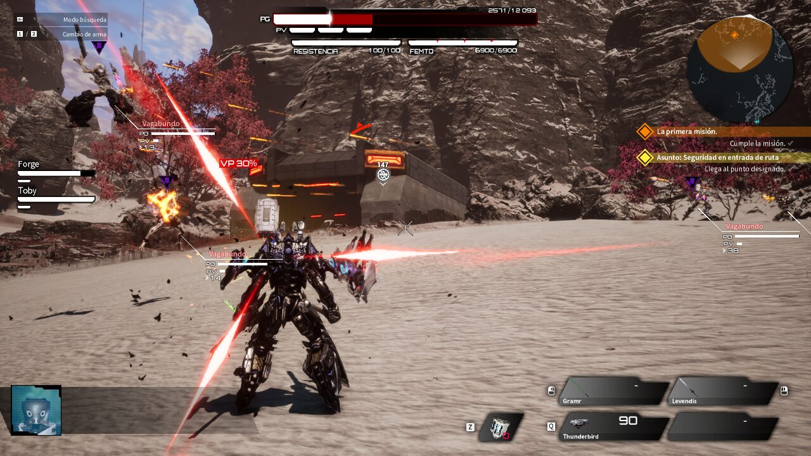
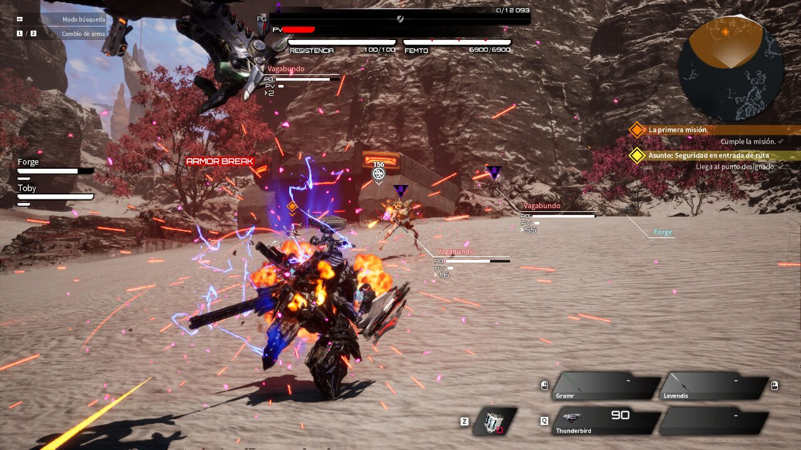
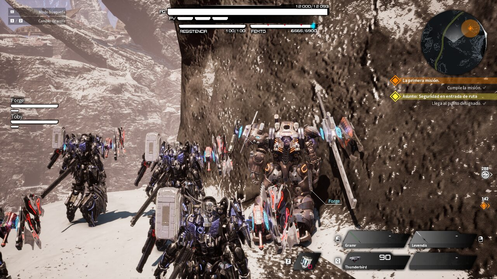
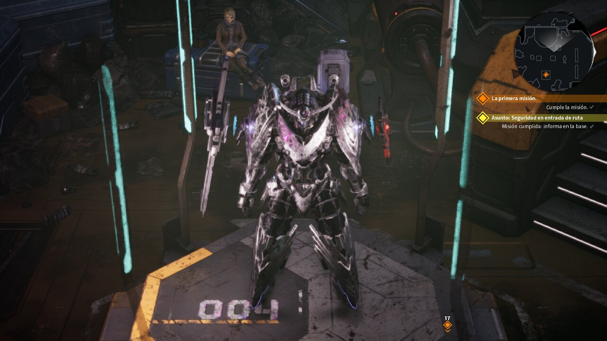
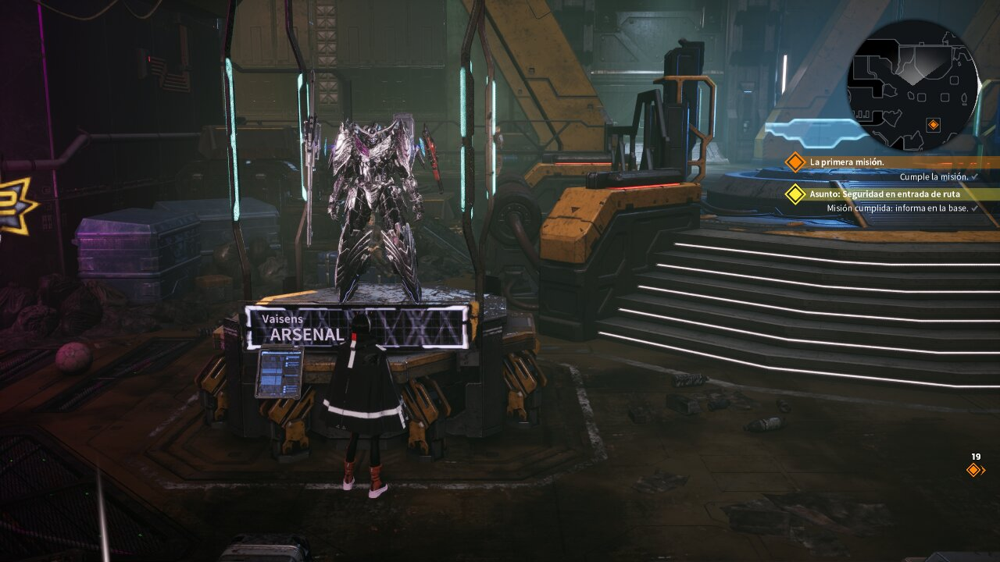

# DAEMON X MACHINA: TITANIC SCION, Escenario para 4 jugadores

Mod que sube de 3 a 4 el límite de jugadores de las salas de **Escenario** (coop) y completa para 4 los cálculos del juego que dependen del número de jugadores. Los modos de batalla (PvP) no cambian.

> **Estado: experimental.** Se ha probado en un PC con Linux con jugadores simulados. Todavía no se ha probado una partida real por internet con 4 personas. Detalles en [Qué está comprobado](#qué-está-comprobado).

## Descarga

En [Releases](../../releases/latest), elige el zip de tu sistema:

- **Windows:** `DXMTS-Coop4-Windows.zip`
- **Linux / Steam Deck:** `DXMTS-Coop4-Linux.zip`

Los dos llevan el mismo pak del mod; solo cambia el instalador.

## ¿Es seguro?

- **No trae programas.** No hay `.exe` ni `.dll`: el instalador es un script de texto que puedes leer (`coop4.ps1` en Windows, `coop4.py` en Linux). No se conecta a internet.
- **Los zips los construye GitHub** a partir de este código y los firma con una atestación de origen. Cualquiera puede comprobar que no se han modificado.
- **Sumas SHA-256** (`SHA256SUMS.txt`) y **análisis en VirusTotal** de cada zip.

Cómo comprobarlo paso a paso: [SEGURIDAD.md](SEGURIDAD.md).

## Requisitos

- **Todos los jugadores de la sala deben instalar el mod** y tener la misma versión del juego.
- Windows: PowerShell (viene con Windows 10 y 11).
- Linux o Steam Deck: `python3`.
- Por ahora reconoce una sola versión del ejecutable `Game-Win64-Shipping.exe`. **La versión que descarga Steam hoy no es compatible**: el instalador lo detecta, avisa y no toca nada.
- No incluye ningún archivo del juego.

## Instalar

1. Cierra el juego.
2. Descomprime la carpeta `DXMTS-Coop4` dentro de la carpeta del juego, la que contiene la carpeta `Game`.
3. Ejecuta el instalador:
   - **Windows:** doble clic en `Instalar-Windows.bat`.
     - Si Windows avisa de que el archivo viene de internet, elige *Más información → Ejecutar de todas formas*.
     - Si el juego está en *Archivos de programa*, ejecútalo como administrador.
   - **Linux / Steam Deck:** ejecuta `instalar-linux.sh`.

El instalador comprueba la versión antes de tocar nada. La primera vez guarda una copia del ejecutable original en la carpeta `_backup_coop4` del juego. Si tenías la versión anterior del mod (solo salas de 4), instala esta encima.

## Desinstalar

- **Windows:** `Desinstalar-Windows.bat`
- **Linux:** `desinstalar-linux.sh`

Devuelve el ejecutable a su estado original, byte a byte, y borra el pak del mod.

**Si actualizas el juego**, la actualización puede deshacer el mod. Vuelve a instalarlo; si la versión nueva ya no se reconoce, el instalador no hará nada.

## Qué cambia

| Cambio | Antes | Con el mod |
|---|---|---|
| Jugadores por sala de Escenario | 3 | 4 (los modos de batalla, igual) |
| Daño de cada jugador a objetos rompibles (estatua gárgola) | 1,00 / 0,55 / 0,40 con 1, 2 o 3 jugadores; con 4 volvía a 1,00 | 0,325 con 4, que sigue la misma serie |
| Tope de enemigos activos por zona | 5 / 5 / 6 / 8 según 1-4 jugadores, pero con 4 caía a 5 | 10 con 4 |
| Colocación lateral de cada jugador en escenas compartidas | sin hueco para el 4.º (quedaban en el mismo sitio) | reparto de 3; el 4.º comparte lado con el 2.º |
| Soportes de mecha en el hangar | 3; el mecha del 4.º salía encima de la vitrina | 4: soporte nuevo en el hueco frente al 3.º, con placa «004» y acceso a ARSENAL |

- El ajuste del ataque enemigo según el número de jugadores ya traía valores para 4 y no se ha tocado.
- Lo que el juego bloquea en multijugador (por ejemplo, cargar partida solo con 1 jugador) sigue mostrando el aviso del propio juego.

### Detalle técnico

- `coop4.py` (Linux) y `coop4.ps1` (Windows) hacen lo mismo: comprueban los bytes originales en 4 posiciones del ejecutable `Game/Binaries/Win64/Game-Win64-Shipping.exe` y los sustituyen. Si un solo byte no coincide, no aplican nada.
  - `sala`: límite de jugadores por modo de sala.
  - `rompibles`: elige la fila de la tabla de daño a rompibles también para 4.
  - `tope`: tope de enemigos por zona con 4 jugadores.
  - `coloc`: colocación lateral con 4.
- `mod/pakchunk99-Windows_P.*`: pak sin cifrar que se copia en `Game/Content/Paks`. Contiene:
  - `BreakableObjectMultiPlayParam`: la tabla de rompibles con la fila de 4 jugadores.
  - `BG_Base000_H000`: el mapa del hangar con una copia del 3.er soporte (`BP_ArsenalBase000_107_C_6`), colocada en espejo en el hueco vacío y añadida como 4.ª posición de la vitrina de mechas (`SpawnPointList`).
  - `T_DecalNumbers008_107` y `MI_DecalNumbers008_107`: textura y material de la placa «004», hechos a partir de la placa «003».

## Qué está comprobado

Probado en un PC con Linux (Proton), con 3 jugadores simulados en el mismo PC y sin red:

- La sala de Escenario admite 4; los modos de batalla siguen en su límite.
- El juego carga el pak: la tabla de rompibles queda en memoria con 4 filas.
- Instalar, reinstalar encima y desinstalar devuelven el ejecutable al original.
- Hangar, base, una misión y el mundo abierto con 4 mechs juntos, sin fallos.
- Hangar con 4: el mecha del 4.º jugador aparece sobre el 4.º soporte, con la placa «004». Al acercarse sale el aviso ARSENAL igual que en los otros tres (el aviso lleva el nombre del jugador local en todos los soportes).
- Combate en el mundo abierto con 4 jugadores en la partida: enemigos atacando, disparos, derribo del jugador y reaparición en el punto de control con los 4, sin cierres del juego.

**Sin comprobar todavía:**

- Una partida real por internet con 4 personas: unirse a la sala, entrar en misión, sincronización y fin de misión.
- Romper la estatua gárgola o llenar una zona de enemigos con 4: los valores nuevos se dedujeron del código del juego y no se han visto en partida.
- Abrir ARSENAL desde el 4.º soporte con un 4.º jugador real: los simulados no reciben controles. El soporte es una copia exacta de los otros, que cualquier jugador usa.
- El instalador en un Windows real. El script de PowerShell se probó con PowerShell 7 en Linux.

Si algo falla, desinstala el mod y abre un *issue* contando qué pasó, en qué misión y con cuántos jugadores.

## Evidencias

Capturas de la prueba con 4 jugadores (1 real y 3 simulados en el mismo PC, sin red). Los jugadores simulados no se mueven ni disparan: solo el primero recibe controles.

| | |
|---|---|
|  Hangar con 4 jugadores |  Base con 4 jugadores |
|  Misión «El fuerte» con 4 |  Mundo abierto con 4 y misión activa |
|  Enemigos atacando |  Combate |
|  Derribo del jugador |  Reaparición con los 4 |
|  4.º soporte del hangar con la placa «004» |  Aviso ARSENAL en el 4.º soporte |

## Licencia y aviso legal

- Los scripts y la documentación se publican con licencia [MIT](LICENSE).
- Los archivos de `mod/` contienen datos modificados del juego, propiedad de sus titulares, y no están cubiertos por esa licencia.
- Este es un proyecto de aficionados, sin relación con Marvelous Inc. Más detalles en [AVISO-LEGAL.md](AVISO-LEGAL.md).

## Créditos

- VinceWasHere.
- Hecho con ayuda de Claude (Anthropic) y de la base de conocimiento de [coop-anything](https://github.com/cranebeaker/coop-anything).
